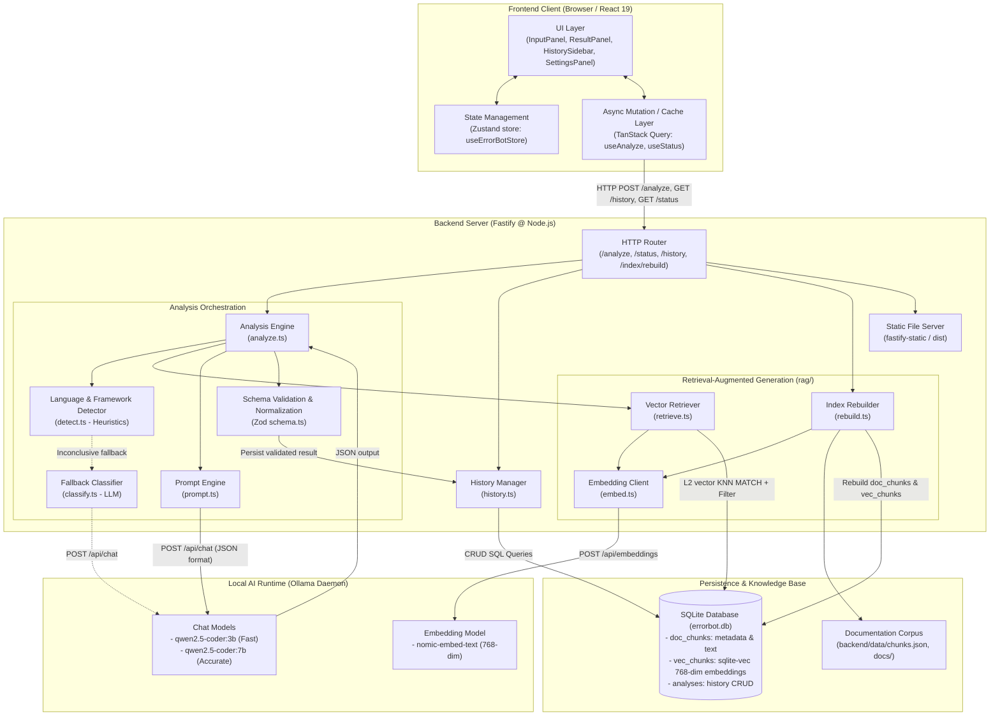
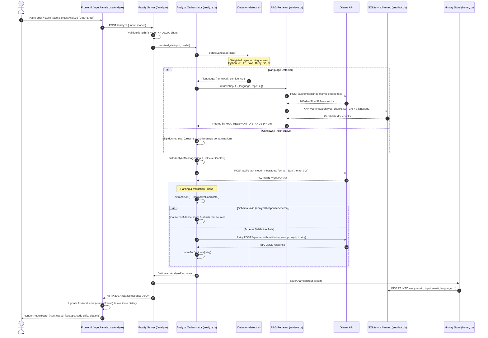
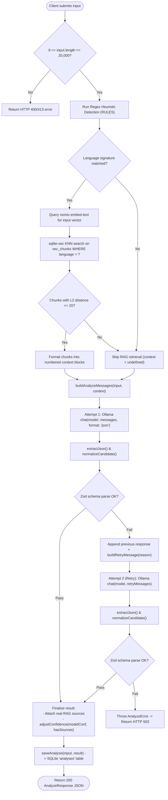
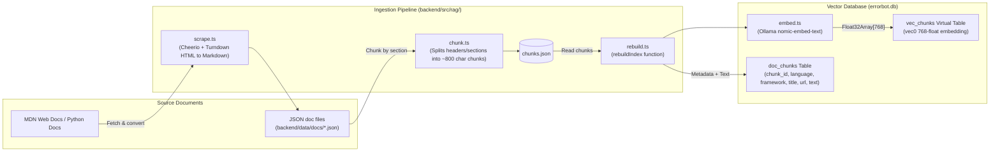
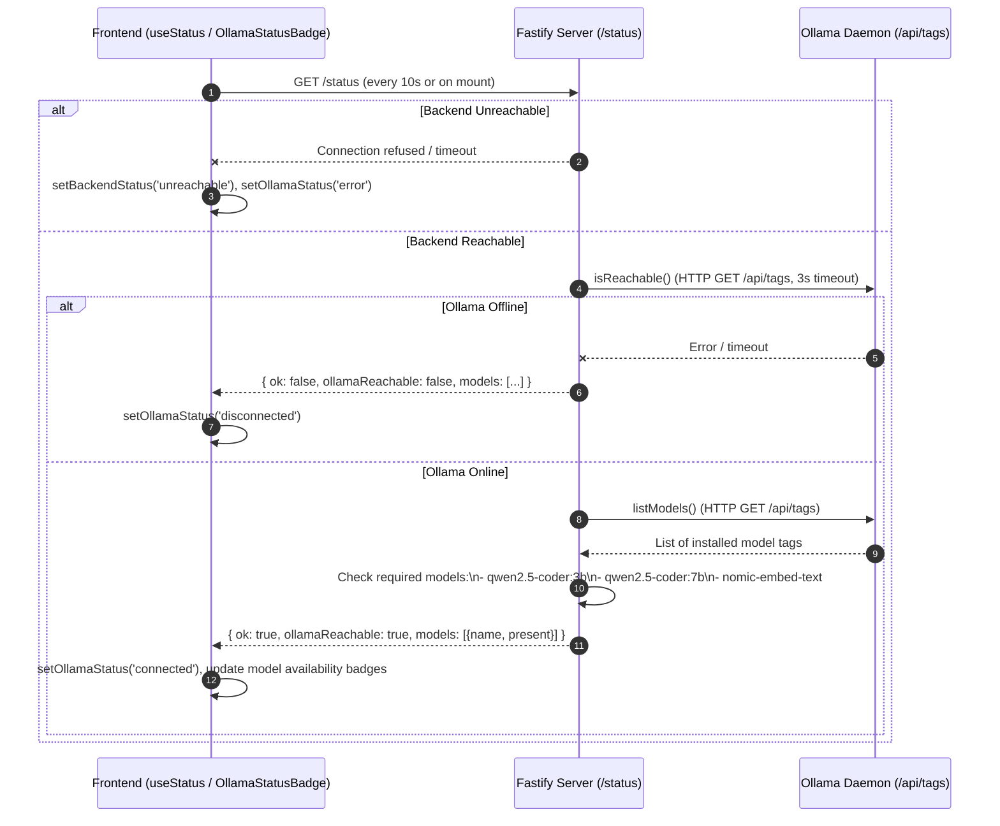
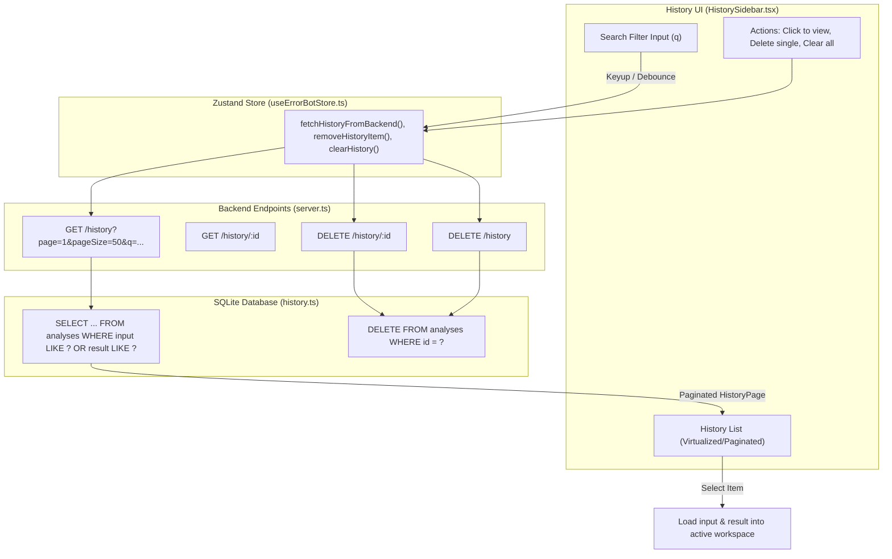

# Error Bot — Architecture & Data Flow

This document details the system architecture, component breakdown, and end-to-end data flows of **Error Bot**, a local-first AI error and stack trace analysis application.

---

## 1. High-Level System Architecture

Error Bot is structured as a client-server application backed by a local AI runtime and an embedded vector database:

- **Frontend**: React 19 single-page application built with Vite, styled with CSS modules / custom styles, using Zustand for global client state and TanStack Query for server mutations and cache management.
- **Backend API**: Fastify HTTP server written in TypeScript (executed via `tsx`), providing REST endpoints for analysis, history management, vector indexing, and health checks. In production, Fastify also serves the pre-compiled static frontend.
- **RAG & Storage**: SQLite database powered by `better-sqlite3` and `sqlite-vec` (vector extension), persisting analysis history and indexing documentation chunks using 768-dimensional embeddings.
- **Local AI Engine**: [Ollama](https://ollama.com) running locally, serving quantized code LLMs (`qwen2.5-coder:3b`, `qwen2.5-coder:7b`) and embedding models (`nomic-embed-text`).

---

## 2. Core Analysis Request & Data Flow (`POST /analyze`)

The primary workflow handles user error input, heuristic identification, RAG document retrieval, grounded prompt construction, LLM generation, validation with 1-shot retry, and persistence.

---

## 3. End-to-End Decision Logic in the Analysis Pipeline

---

## 4. Documentation Ingestion & RAG Indexing Flow

Error Bot includes a modular scraping, chunking, and vector indexing pipeline that prepares official documentation for retrieval:

---

## 5. Health Check & Monitoring Flow (`GET /status`)

The frontend continuously monitors backend and Ollama connectivity:

---

## 6. History Management Data Flow

Past analyses are indexed and searchable directly in the user interface:

---

## 7. Component & Module Reference

| Directory / File | Role | Key Responsibilities |
|---|---|---|
| `backend/src/server.ts` | Server Entry Point | Fastify server setup, CORS configuration, static file serving (`dist/`), route registrations (`/status`, `/analyze`, `/history`, `/index/rebuild`). |
| `backend/src/analyze.ts` | Analysis Engine | Pipeline coordinator: triggers detection, invokes RAG retrieval, formats prompts, handles JSON parsing and 1-shot retry, normalizes outputs, adjusts confidence. |
| `backend/src/detect.ts` | Heuristic Detector | Weighted regex scoring rules for 9 languages (Python, JS, TS, Java, Ruby, Go, C#, PHP, Rust) and major frameworks (React, Django, Express, Spring, etc.). |
| `backend/src/classify.ts` | Fallback Classifier | Fallback classifier invoking Ollama chat when heuristics are inconclusive. |
| `backend/src/ollama.ts` | Ollama HTTP Client | Minimal REST client for Ollama's `/api/chat` and `/api/tags` with timeout and health check helpers. |
| `backend/src/prompt.ts` | Prompt Construction | System prompts enforcing strict JSON response format and context grounding instructions. |
| `backend/src/history.ts` | History Persistence | CRUD operations on the SQLite `analyses` table, including keyword text search and pagination. |
| `backend/src/rag/db.ts` | Vector Database Core | `better-sqlite3` instance management with `sqlite-vec` extension loading and table schema setup (`doc_chunks`, `vec_chunks`). |
| `backend/src/rag/embed.ts` | Embeddings Client | Sends text to Ollama `/api/embeddings` using `nomic-embed-text` to generate 768-dim `Float32Array`. |
| `backend/src/rag/retrieve.ts` | Vector Retrieval | Performs vector KNN similarity queries against `vec_chunks`, applies strict language filtering and distance thresholds. |
| `backend/src/rag/rebuild.ts` | Index Builder | Reads `chunks.json`, computes embeddings, and re-populates the vector index. |
| `shared/schema.ts` | Contract & Validation | Zod schemas (`analyzeResponseSchema`, `codeExampleSchema`, `sourceSchema`) used for runtime validation on both client and server. |
| `shared/types.ts` | TypeScript Interfaces | Shared TypeScript types derived from schemas and API contracts. |
| `src/store/useErrorBotStore.ts` | Client State | Central Zustand store managing current inputs, active analysis results, UI status, selected model, and history cache. |
| `src/hooks/useAnalyze.ts` | Analysis Hook | TanStack Query mutation wrapper managing request status and triggering history refreshes. |
| `src/components/` | React UI Components | `InputPanel` (editor with line gutters), `ResultPanel` (root cause, fix steps, diffs), `HistorySidebar`, `SettingsPanel`, status banners. |
